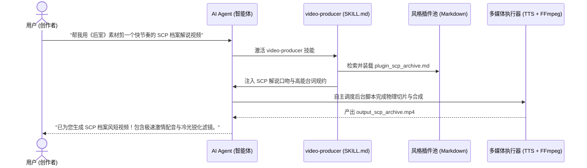

# Pluggable Video Producer Skill (可插拔智能体视频创作技能)

> 🤖 **这是一个开箱即用的 AI Agent Skill（智能体技能）**：遵循可插拔技能规范，让你的 AI 编程助手（如 Antigravity / Claude Code / Cursor / 自定义 Agent）拥有多风格、去同质化的自动化视频创作与剪辑能力。

[中文](README.md) | [English](README_EN.md)

🔗 **底层规范仓库**：[Ikaros-521/pluggable-skills](https://github.com/Ikaros-521/pluggable-skills)

---

## 💡 为什么是 Skill，而不是死板的 Python 脚本？

传统的自动化脚本要求用户在命令行中手动输入参数并敲命令，毫无智能可言。

而作为一个 **Agent Skill**：
1. **纯自然语言交互**：你只需要在聊天框对 Agent 说一句需求，Agent 会自主思考、挂载对应插件，并在后台自动调度多媒体工具合成视频。
2. **零同质化热插拔**：觉得生成的视频千篇一律？无需改动任何代码，只需在 `plugins/` 扔一个单文件 Markdown，Agent 立即学会全新的文风、专属音色与剪辑调色！



---

## 🛠️ 如何在你的 Agent 中安装与使用

### 1. 安装 Skill 到工作区
将本项目中的 `skills/video-producer` 目录放置在您的工作区（如 Antigravity 项目的 `.agents/skills/` 目录下）：

```text
your-project/
└── .agents/
    └── skills/
        └── video-producer/      # 复制本项目中的整个技能目录
            ├── SKILL.md         # 技能定义与 SOP
            ├── plugins/         # 风格插件池
            └── scripts/         # 后台执行工具
```

### 2. 在对话框中自然语言唤醒
直接在聊天窗口对你的 AI Agent 发送指令：

> 💬 **指令示例 1（悬疑心理恐怖风）**：  
> *“帮我用素材 `F:\【视频】\《后室》预告片，深度解读.mp4`，做一段低沉压抑的伪纪录片惊悚短视频。”*  
> ➡️ **Agent 自主行为**：识别意图 $\rightarrow$ 激活 `plugin_analog_horror.md` $\rightarrow$ 调度 `zh-CN-YunjianNeural` 阴郁低语人声 $\rightarrow$ 应用复古黄绿暗角滤镜 $\rightarrow$ 生成 `output_analog_horror.mp4`。

> 💬 **指令示例 2（极客高能快解说风）**：  
> *“用同一个后室素材，换个风格，帮我做一个快节奏轰炸的 SCP 异常调查档案解说！”*  
> ➡️ **Agent 自主行为**：识别意图 $\rightarrow$ 切换挂载 `plugin_scp_archive.md` $\rightarrow$ 调度 `zh-CN-YunxiNeural` 极速激情科技男声 $\rightarrow$ 应用冷光高对比锐化滤镜 $\rightarrow$ 生成 `output_scp_archive.mp4`。

---

## 🎨 3分钟制作新插件：彻底消灭同质化

如果现有的风格不能满足你的要求，**创作者完全不需要懂代码**，只需在 `skills/video-producer/plugins/` 下新建一个 `.md` 文件：

```markdown
---
slot: "video_style"
id: "cyber-punk"
name: "赛博朋克霓虹风"
version: "1.0.0"
voice_id: "zh-CN-YunxiNeural"
rate: "+10%"
clip_start: "30.0"
filter_preset: "cyber_scp"
description: "充满霓虹光影反差的未来主义解说"
---

## 旁白剧本
夜幕低垂，霓虹灯管在潮湿的地面倒映出血红色的警示代码。欢迎来到算力过剩的荒原……
```

保存后，告诉你的 Agent：*“用赛博朋克风帮我剪视频”*，Agent 就能立即执行！

---

## 📂 项目结构

```text
pluggable-video-producer/
├── README.md                      # 中文使用指引 (本文档)
├── README_EN.md                   # 英文说明文档
├── LICENSE                        # MIT 开源协议
├── skills/
│   └── video-producer/            # 🌟 核心技能包 (可直接集成到 Agent)
│       ├── SKILL.md               # Agent 技能规约与调度流程
│       ├── plugins/               # 🌟 可插拔风格插件库 (零代码纯文本)
│       │   ├── plugin_analog_horror.md # 伪纪录片恐怖风插件
│       │   └── plugin_scp_archive.md   # SCP异常档案快解说插件
│       └── scripts/               # 技能专用后台执行器
│           └── producer_runner.py # 供 Agent 自主调用的音视频物理合成工具
└── output/                        # Agent 生成的成品视频
    ├── output_analog_horror.mp4
    └── output_scp_archive.mp4
```

---

## 📄 开源许可证

本项目遵循 [MIT License](./LICENSE) 协议。
欢迎为本项目贡献更多精彩的领域风格插件！
