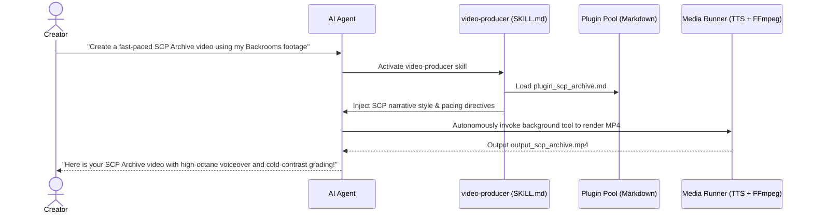

# Pluggable Video Producer Skill

> 🤖 **A Production-Ready AI Agent Skill**: Built on the Pluggable Skills specification, equipping your AI Agent (Antigravity / Claude Code / Cursor / Custom Agents) with automated, multi-styled, non-homogenized video creation and editing capabilities.

[English](README_EN.md) | [中文](README.md)

🔗 **Core Specification Repo**: [Ikaros-521/pluggable-skills](https://github.com/Ikaros-521/pluggable-skills)

---

## 💡 Why a Skill, Not a Rigid Script?

Traditional script tools require developers to fiddle with CLI flags and execute terminal commands manually.

As a true **Agent Skill**:
1. **Natural Language Driven**: Simply talk to your Agent in natural language. The Agent autonomously understands intent, mounts the matching plugin, and orchestrates media tools in the background.
2. **Zero-Homogenization Hot-Plugging**: Tired of cookie-cutter output? Just drop a single-file Markdown in `plugins/` (zero code). Your Agent immediately masters a new narrative voice, custom timbre, and visual color grading!



---

## 🛠️ How to Install & Use in Your Agent

### 1. Install the Skill
Copy the `skills/video-producer` directory into your Agent's workspace (e.g. `.agents/skills/`):

```text
your-project/
└── .agents/
    └── skills/
        └── video-producer/      # Copy this folder
            ├── SKILL.md         # Skill definition & SOP
            ├── plugins/         # Style plugins
            └── scripts/         # Background runner tools
```

### 2. Natural Language Activation in Chat
Interact with your AI Agent naturally:

> 💬 **Example Prompt (Psychological Horror)**:  
> *"Using the footage `F:\【视频】\《后室》预告片，深度解读.mp4`, make an eerie, slow-burn psychological horror short."*  
> ➡️ **Agent Action**: Matches intent $\rightarrow$ Mounts `plugin_analog_horror.md` $\rightarrow$ Synthesizes `zh-CN-YunjianNeural` somber voice $\rightarrow$ Applies vintage VHS tint $\rightarrow$ Delivers `output_analog_horror.mp4`.

> 💬 **Example Prompt (Multi-Video Montage)**:  
> *"Take multiple clips from `F:\【视频】` and edit them into a rapid-fire SCP Archive montage!"*  
> ➡️ **Agent Action**: Detects folder input $\rightarrow$ Pulls clips from asset pool at 2.0s/shot pace $\rightarrow$ Normalizes dimensions to 1080p and concatenates seamlessly $\rightarrow$ Delivers `output_montage_scp.mp4`.

---

## 🎨 Author a New Plugin in 3 Minutes

Creators don't need to write Python code. Simply create a `.md` file in `skills/video-producer/plugins/`:

```markdown
---
slot: "video_style"
id: "cyber-punk"
name: "Cyberpunk Neon"
version: "1.0.0"
voice_id: "zh-CN-YunxiNeural"
rate: "+10%"
clip_start: "30.0"
filter_preset: "cyber_scp"
description: "Futuristic neon-soaked sci-fi breakdown"
---

## 旁白剧本
Night falls, and neon tubes cast red reflection warnings across the wet pavement...
```

Tell your Agent: *"Cut the video in Cyberpunk style"*, and it executes immediately!

---

## 📂 Repository Structure

```text
pluggable-video-producer/
├── README.md                      # Chinese documentation
├── README_EN.md                   # English documentation (this file)
├── LICENSE                        # MIT License
├── skills/
│   └── video-producer/            # 🌟 Core Agent Skill
│       ├── SKILL.md               # Agent execution SOP & directives
│       ├── plugins/               # 🌟 Pluggable Markdown style plugins
│       │   ├── plugin_analog_horror.md
│       │   └── plugin_scp_archive.md
│       └── scripts/               # Background tools called by Agent
│           └── producer_runner.py # FFmpeg & TTS runner
└── output/                        # Physical MP4 outputs generated by Agent
    ├── output_analog_horror.mp4
    └── output_scp_archive.mp4
```

---

## 📄 License

Licensed under the [MIT License](./LICENSE).
